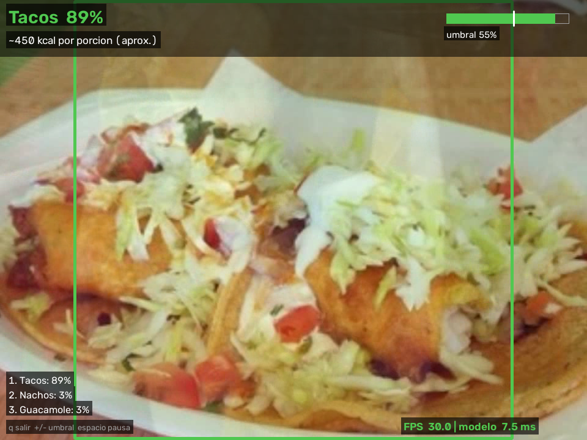
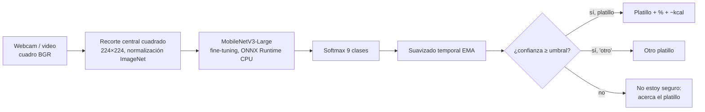
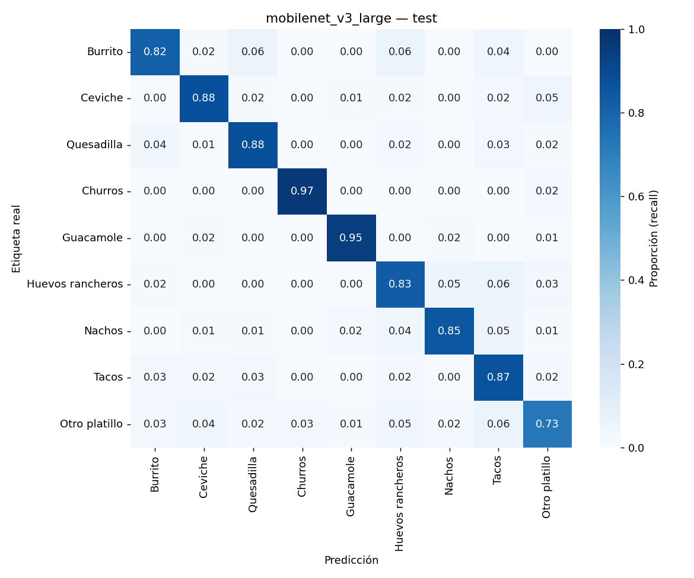
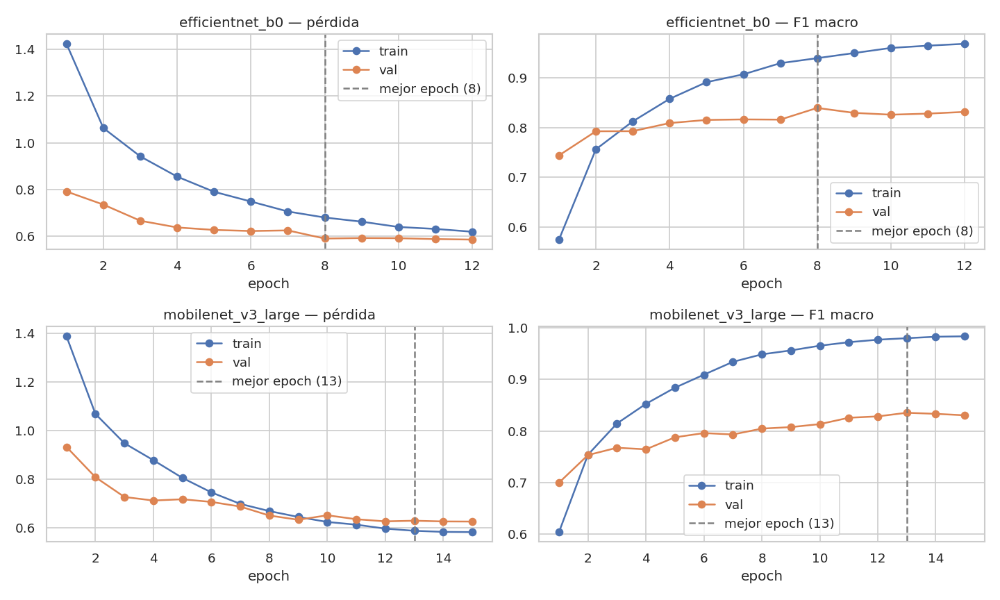

# NutriVisión MX 🌮

**Clasificación de platillos mexicanos en tiempo real con estimación de calorías**

Proyecto final · Visión por computadora / Deep Learning · Licenciatura en Inteligencia Artificial y Ciencia de los Datos · CUGDL, Universidad de Guadalajara · Noviembre 2026



---

## 1. Problema y usuario

Llevar un diario de alimentación es una de las intervenciones con más evidencia para controlar el peso. En México, ~3 de cada 4 adultos viven con sobrepeso u obesidad (ENSANUT). El problema es que **registrar cada comida a mano es tedioso**, y las apps que reconocen fotos de comida fallan con platillos mexicanos.

**Usuario:** una persona que lleva control de su dieta. Apunta la cámara a su plato y el sistema le dice qué platillo es y cuántas calorías tiene aproximadamente, en tiempo real y **sin enviar la foto a ningún servidor**. Usuarios secundarios: nutriólogos y apps de bienestar.

Caso completo: [`docs/caso_sector.pdf`](docs/caso_sector.pdf).

## 2. Integrantes

Proyecto **individual**.

| Nombre completo | Código | Rol |
|---|---|---|
| Oscar David Guzmán Mares | 219872688 | Todo el proyecto: datos, modelo, evaluación, app y documentación |

## 3. Conjunto de datos

- **Fuente:** subconjunto de [Food-101](https://data.vision.ee.ethz.ch/cvl/datasets_extra/food-101/) (ETH Zürich, uso académico). Son fotos reales de celular tomadas por comensales.
- **9 clases:** Burrito, Ceviche, Quesadilla, Churros, Guacamole, Huevos rancheros, Nachos, Tacos y **Otro platillo** (una muestra de los 93 platillos restantes, para no forzar todo a "comida mexicana").
- **9,466 imágenes** después de la limpieza:

  | Partición | Imágenes |
  |---|---:|
  | Train | 6,079 |
  | Val | 1,013 |
  | Test | 2,374 |

- **Prueba fuera de distribución:** 80 imágenes de **ISIA Food-500**, un conjunto independiente (ver la sección 5 y el datasheet).
- **Particiones sin fuga:**
  - Test es la partición oficial y solo se usa al final.
  - Se eliminaron **6 imágenes de train que eran casi-duplicadas de test** (detectadas con pHash).
  - Train y val se separan **por clúster de duplicados**, para que copias de una misma foto no queden repartidas.
  - Detalle en `src/make_splits.py`.
- **Revisión manual de 40 etiquetas:** 5 % incorrectas (se excluyen) y 12.5 % dudosas.

Ficha completa: [`docs/datasheet.md`](docs/datasheet.md) · Análisis exploratorio: [`notebooks/01_exploracion_datos.ipynb`](notebooks/01_exploracion_datos.ipynb)

## 4. Arquitectura



**Modelo elegido: MobileNetV3-Large** (preentrenado en ImageNet, con fine-tuning completo).

- Detalles del entrenamiento:
  - Cabeza nueva de 9 salidas.
  - AdamW con learning rate 10 veces mayor en la cabeza.
  - Learning rate con decaimiento coseno.
  - Pérdida ponderada por clase con label smoothing de 0.1.
  - Early stopping sobre el F1 macro de validación.
- **¿Por qué esta arquitectura y no EfficientNet-B0?** Entrenamos ambas con el mismo protocolo (tabla abajo y [`docs/comparacion_arquitecturas.md`](docs/comparacion_arquitecturas.md)).
- **Resultado del experimento:** las dos empatan en calidad (F1 macro de prueba 0.859 contra 0.859), pero **MobileNetV3-Large es 1.75 veces más rápida en CPU** con ONNX (7.2 ms contra 12.6 ms en la Mac M4) y 1.9 veces más rápida en PyTorch. Como la app corre en el dispositivo del usuario y en tiempo real, a igual F1 decide la latencia.

  | Arquitectura | Parámetros | F1 val | F1 test | Top-3 test | Latencia PyTorch CPU | Latencia ONNX CPU |
  |---|---:|---:|---:|---:|---:|---:|
  | **MobileNetV3-Large** | 4.21 M | 0.835 | **0.859** | 0.965 | 72.9 ms | **7.2 ms** |
  | EfficientNet-B0 | 4.02 M | 0.839 | 0.859 | 0.966 | 138.7 ms | 12.6 ms |

  Ambas se entrenaron con los mismos datos, aumentos, optimizador, semilla y criterio de paro, en GPU T4 de Colab. La latencia se midió en la laptop de la demo (Apple M4, CPU, 4 hilos).

## 5. Resultados principales

Modelo final: MobileNetV3-Large. Prueba oficial de Food-101 (2,374 imágenes), **evaluada una sola vez**.

| Métrica | Valor |
|---|---:|
| **F1 macro** | **0.859** |
| Exactitud | 0.856 |
| Exactitud top-3 | 0.965 |
| F1 macro fuera de distribución (ISIA Food-500, 80 imágenes, 7 clases) | 0.767, contra 0.837 en Food-101 con las mismas clases |
| Exactitud con umbral 0.55 (responde en 82.4 % de las fotos) | 0.925 |
| FPS de la app (pipeline completo, Mac M4, ONNX FP32) | 68 FPS; con webcam, limitado a los 30 FPS de la cámara |

| Matriz de confusión (prueba) | Curvas de entrenamiento |
|---|---|
|  |  |

- **Sobreajuste controlado:**
  - La pérdida de validación baja durante todo el entrenamiento (0.93 → 0.63), sin repuntar.
  - Queda una brecha de exactitud train/val (0.98 contra 0.83), así que hay sobreajuste moderado. Lo contienen el early stopping sobre el F1 de validación (mejor epoch: 13 de 15), el aumento de datos, el weight decay y el label smoothing.
  - EfficientNet-B0 se detuvo sola en el epoch 12 (mejor: 8).
- **Desbalance:** "otro" tiene 1.47 veces más imágenes que cada platillo. Se atiende con pesos de clase en la pérdida y F1 macro como métrica.
- **Exportación:**

  | Variante | Tamaño | F1 test | Latencia (M4 CPU) |
  |---|---:|---:|---:|
  | PyTorch FP32 | 16.9 MB | 0.859 | 72.9 ms |
  | ONNX FP32 | 16.8 MB | 0.859 | 7.2 ms |
  | ONNX INT8 | 8.4 MB | 0.808 | 4.4 ms |

- **Errores:** 343, agrupados en 5 tipos en [`docs/analisis_errores.md`](docs/analisis_errores.md). Los más comunes son "otro platillo" confundido con un platillo mexicano y confusiones entre platillos de tortilla de harina.
- **Interpretabilidad (Grad-CAM):** el modelo mira el platillo cuando tiene un rasgo distintivo, pero también usa **acompañamientos como atajo** (pico de gallo → tacos, taza de chocolate → churros). Ver [`docs/interpretabilidad.md`](docs/interpretabilidad.md).
- **Subgrupos:** brechas de F1 ≤ 2.6 puntos por iluminación, temperatura de color y nitidez.
- **Más detalle:**
  - [`docs/robustez_y_despliegue.md`](docs/robustez_y_despliegue.md): fuera de distribución, perturbaciones, subgrupos, cuantización y FPS.
  - [`docs/costos.md`](docs/costos.md): costos del proyecto.
  - [`MODEL_CARD.md`](MODEL_CARD.md): model card.

## 6. Instalación y reproducción (5 comandos)

Requisitos: Python 3.12 y unos 2 GB libres (el dataset se descarga como *stream*: lee ~5 GB por red y guarda ~300 MB).

```bash
pip install -r requirements.txt
python data/download.py && python -m src.make_splits
python -m src.train --arch mobilenet_v3_large && python -m src.train --arch efficientnet_b0
python -m src.evaluate --arch mobilenet_v3_large --split test && python -m src.evaluate --arch efficientnet_b0 --split test && python -m src.download_ood && python -m src.evaluate --arch mobilenet_v3_large --split ood
python -m src.export --arch mobilenet_v3_large && python -m src.export --arch efficientnet_b0 && python -m src.compare && python -m src.gradcam
```

- **Semilla fija:** 42 en Python, NumPy, PyTorch y los workers del DataLoader (`src/utils.py`).
- **Hardware usado:** los modelos reportados se entrenaron en **Google Colab (GPU T4)** con el notebook autocontenido `NutriVision_Colab.ipynb`, que corre todo el pipeline con "Ejecutar todo". La latencia y los FPS se midieron en una MacBook con Apple M4.
- **Determinismo:** en GPU (CUDA o MPS) algunas operaciones no son deterministas bit a bit, así que las métricas pueden variar en la tercera cifra decimal.
- **Pesos ya entrenados:** `best.pt`, `model.onnx` y `model_int8.onnx` están en los **Releases** del repositorio. Para usarlos sin entrenar, cópialos a `runs/mobilenet_v3_large/`.

## 7. Cómo correr la demo (un comando)

```bash
python app/demo.py --source 0
```

- **Fuente de video:**
  - `--source 0`: webcam.
  - `--source app/demo.mp4`: video en flujo. Ese video se genera con `python app/make_demo_video.py`.
- **Modelo cuantizado:** `--int8` usa el modelo INT8.
- **Controles:**
  - Slider o teclas **+/-**: umbral de confianza.
  - **espacio**: pausa.
  - **s**: captura de pantalla.
  - **q**: salir.

En pantalla se muestran el platillo, la confianza, el top-3, las calorías aproximadas, los FPS y la latencia del modelo.

**Sin instalar nada:** las últimas celdas de `NutriVision_Colab.ipynb` abren la webcam desde Colab y clasifican en vivo. Como cada cuadro viaja por internet, ahí se ven 5–15 FPS; la demo oficial de tiempo real es la local.

## 8. Video de respaldo

🎥 _Pendiente: enlace al video de 1–2 min (YouTube no listado o Drive)._

## 9. Limitaciones

1. **Solo 8 platillos mexicanos.** Enchiladas, pozole, chilaquiles, tamales, etc. no se reconocen: caen en "otro" o se confunden.
2. **Las calorías son un promedio por porción típica.** El sistema no mide la cantidad servida. No es un dispositivo médico.
3. **Sesgo Tex-Mex:** Food-101 viene de restaurantes de EE. UU. y Europa. Fuera de distribución, el F1 baja ~7 puntos, y aún falta validar con fotos tomadas en México.
4. **Atajos de contexto:** los acompañamientos (pico de gallo, totopos, taza de chocolate) influyen en la predicción.
5. **31 errores con confianza ≥ 80 %** en la prueba (1.3 %). El umbral no los atrapa; falta calibrar las probabilidades.
6. **Frágil a ruido y desenfoque fuertes**, y a fotos en pantalla con mucho reflejo o moiré.
7. **La versión INT8 pierde 5 puntos de F1.** Por eso la demo usa FP32.
8. **Ruido de etiquetas en Food-101** (~5 % en la muestra revisada).

Ver también [`MODEL_CARD.md`](MODEL_CARD.md) y [`docs/informe_etico.pdf`](docs/informe_etico.pdf).

## 10. Uso de IA generativa y créditos

- **IA generativa:** se usó **Claude (Anthropic)** como asistente para generar la estructura del repositorio, el código base y los borradores de la documentación. El autor revisó, ejecutó y validó todo el código y los resultados, que son reproducibles con los comandos de la sección 6. La revisión manual de etiquetas fue validada por el autor.
- **Datasets:** Bossard, L., Guillaumin, M., & Van Gool, L. (2014). *Food-101 – Mining Discriminative Components with Random Forests*. ECCV. · Min, W. et al. (2020). *ISIA Food-500: A Dataset for Large-Scale Food Recognition via Stacked Global-Local Attention Network*. ACM MM.
- **Modelos preentrenados:** torchvision (MobileNetV3: Howard et al., 2019; EfficientNet: Tan & Le, 2019).
- **Grad-CAM:** Selvaraju et al., 2017. Implementación propia en `src/gradcam.py`.
- **Calorías de referencia:** USDA FoodData Central y Sistema Mexicano de Alimentos Equivalentes (valores promedio redondeados).
- **Bibliotecas:** PyTorch, ONNX Runtime, OpenCV, scikit-learn, ImageHash.

## Estructura del repositorio

```
├── README.md · MODEL_CARD.md · NutriVision_Colab.ipynb · requirements.txt · LICENSE · .gitignore
├── data/        download.py, README.md (los datos NO se versionan)
├── src/         config, make_splits, data, models, train, evaluate, gradcam, export, compare, robustness, subgroups, prepare_ood, download_ood
├── app/         demo.py (tiempo real), make_demo_video.py, capture_ood.py
├── eval/        robustez.ipynb, auditoria_subgrupos.ipynb, analisis_errores.ipynb
├── notebooks/   01_exploracion_datos, 02_curvas_entrenamiento, 03_revision_etiquetas
├── runs/        métricas, historiales y tablas por arquitectura (pesos en Releases)
└── docs/        datasheet.md, caso_sector.pdf, costos.md, robustez_y_despliegue.md,
                 informe_etico.pdf, interpretabilidad.md, defensa.pdf, figuras/
```
