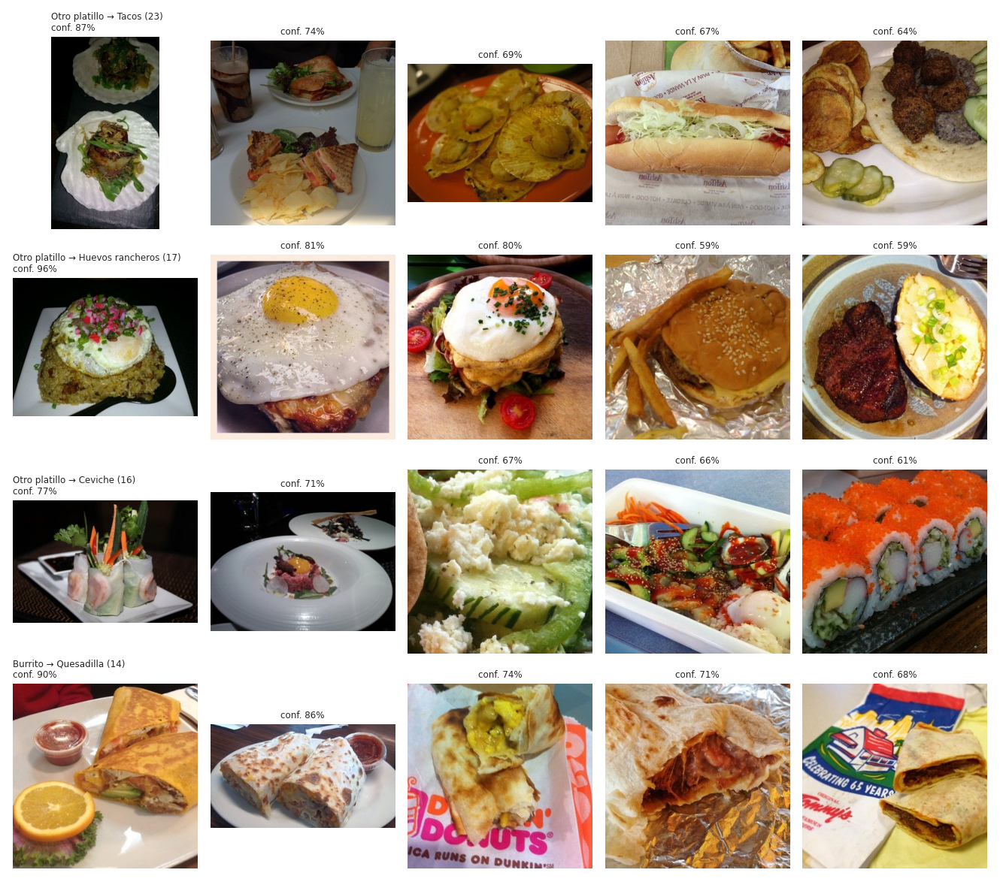

# Análisis de errores (D3)

**Modelo:** MobileNetV3-Large (versión final, entrenada en Colab). **Conjunto:** prueba de Food-101, con 2,374 imágenes. **Errores:** 343 (14.4 %).

Para reproducir: `eval/analisis_errores.ipynb`.

## Errores agrupados por tipo

| Tipo | Pares más frecuentes (n) | Ejemplos | Hipótesis de causa |
|---|---|---|---|
| **1. Apariencia compartida con un platillo internacional** | Otro → Tacos (23), Otro → Huevos rancheros (17), Otro → Ceviche (16), Otro → Churros (12), Otro → Burrito (11) | Arroz frito con huevo estrellado → huevos rancheros. Hummus con pan pita → quesadilla. Postres fritos → churros | `otro` reúne 93 platillos con unas 10 imágenes de entrenamiento cada uno. El modelo ve muy pocos ejemplos de cada "impostor" y lo asigna a la clase mexicana que comparte **un elemento clave** (huevo, pan plano, color dorado de fritura) |
| **2. Platillos de tortilla de harina** | Burrito → Quesadilla (14), Burrito → Huevos rancheros (14), Burrito → Tacos (11) | Burrito "mojado" en salsa roja → huevos rancheros. Tortillas enrolladas → burrito | **Ambigüedad visual real**: comparten tortilla, salsa roja, queso fundido y acompañamientos. Grad-CAM muestra que el modelo mira la salsa encima, no la forma enrollada |
| **3. Sesgo de contexto (*shortcut*)** | Huevos rancheros → Tacos (14), Huevos rancheros → Nachos (13), Nachos → Tacos (13) | Huevos rancheros servidos con pico de gallo y lechuga → tacos. Plato con totopos y guacamole → nachos | El modelo aprendió que ciertos **acompañamientos** (pico de gallo, lechuga, totopos) van con ciertos platillos. Ver `docs/interpretabilidad.md` |
| **4. Etiqueta probablemente incorrecta en prueba** | Quesadilla → Otro (93 %) | La foto parece una enchilada o burrito bañado en salsa verde | Food-101 etiqueta por **lo que escribió el usuario**, no por lo que se ve. El "error" del modelo es razonable. La revisión manual de train encontró 5 % de etiquetas incorrectas, y en test se espera algo parecido |
| **5. Platillo pequeño o poco visible** | Ceviche → Otro (12) | Ceviche servido en copa al fondo de la mesa | El recorte central de 224×224 deja el platillo pequeño y la escena domina. En la app se mitiga **acercando la cámara**, y el mensaje "No estoy seguro" lo pide |

## Errores con confianza alta (≥ 80 %)

Son **31 casos (1.3 % del test)**. Son los más peligrosos, porque **el umbral de la app no los atrapa**. Se concentran en el tipo 2 (Burrito ↔ Quesadilla ↔ Huevos rancheros ↔ Tacos) y en ceviche servido en porciones (→ tacos).

## Efecto del umbral de confianza (abstención)

| Umbral | Imágenes con respuesta | Exactitud en las que responde |
|---:|---:|---:|
| sin umbral | 100 % | 85.6 % |
| 0.40 | 93.7 % | 88.3 % |
| **0.55 (default de la app)** | **82.4 %** | **92.5 %** |
| 0.70 | 69.9 % | 96.0 % |

Con el umbral por defecto la app se abstiene en ~18 % de las fotos y, a cambio, acierta 92.5 % de las veces que sí responde.

**Mitigación propuesta:** calibrar las probabilidades (*temperature scaling* con validación) y mostrar el **top-3** para que el usuario elija. El top-3 acierta en **96.5 %** de los casos.
