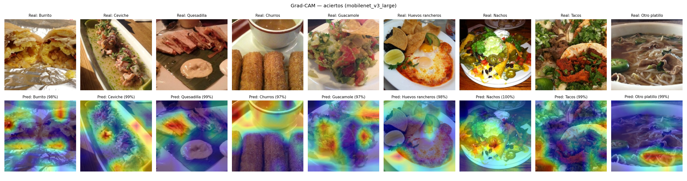
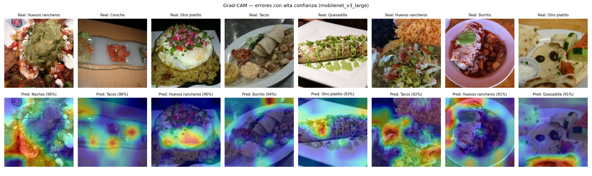

# Interpretabilidad: ¿en qué se fija el modelo? (Avance A)

**Método:** Grad-CAM (Selvaraju et al., 2017), con implementación propia en [`src/gradcam.py`](../src/gradcam.py).

- **Capa analizada:** la última capa convolucional de MobileNetV3-Large (`features[-1]`, 960 canales de 7×7).
- **Cómo se calcula:**
  1. Se calcula el gradiente del logit de la clase predicha respecto a cada canal.
  2. Se promedia ese gradiente espacialmente; el resultado es el peso del canal.
  3. Se hace una suma ponderada de los canales y se aplica una ReLU.
  4. El mapa se re-escala a 224×224.
- **Lectura:** rojo indica las zonas que más empujan la predicción hacia esa clase.
- **Para reproducir:** `python -m src.gradcam --arch mobilenet_v3_large`

> **Versión final:** figuras regeneradas con el modelo definitivo, entrenado en GPU (Colab T4). Algunos ejemplos cambiaron respecto al avance del 24 de noviembre, y las conclusiones se ajustaron a lo que muestran las figuras nuevas.

## 1. Aciertos con alta confianza (uno por clase)

| Clase | ¿Dónde mira? | Interpretación |
|---|---|---|
| Burrito (98 %) | El corte transversal: relleno de huevo y papa en las dos mitades. Casi ignora el papel aluminio | ✅ Usa la característica correcta |
| Ceviche (99 %) | Los trozos de pescado con hierbas al centro del plato | ✅ Correcta |
| Quesadilla (99 %) | La rebanada de quesadilla; la crema del acompañamiento casi no pesa | ✅ Correcta en este ejemplo |
| **Churros (97 %)** | **La taza de chocolate** de arriba, más que los churros | ⚠️ **Contexto**: aprendió que el chocolate acompaña a los churros |
| Guacamole (97 %) | El picado verde con jitomate, repartido en todo el plato | ✅ Correcta |
| Huevos rancheros (98 %) | Zona del huevo con salsa | ✅ Correcta |
| Nachos (100 %) | Totopos con queso y jalapeño al centro | ✅ Correcta |
| Tacos (99 %) | Carne con cilantro en el borde y la tortilla de abajo | ⚠️ Mezcla de relleno y bordes |
| Otro platillo: pho (99 %) | Caldo y carne en la parte de abajo del tazón | Esperado: clase heterogénea, usa la textura del caldo |

## 2. Errores con alta confianza

| Real → Predicho | Lo que muestra Grad-CAM | Hipótesis |
|---|---|---|
| Huevos rancheros → Nachos (96 %) | Totopos y la orilla inferior izquierda, bajo el guacamole | **Contexto de acompañamiento**: el plato trae totopos y guacamole encima, los rasgos de nachos |
| Ceviche → Tacos (96 %) | Las tres porciones rojas pequeñas en plato alargado | **Presentación**: porciones individuales en fila, como una orden de tacos |
| Otro (arroz frito con huevo) → Huevos rancheros (96 %) | **El huevo estrellado** | **Rasgo compartido**: para el modelo, huevo estrellado = huevos rancheros |
| Tacos → Burrito (94 %) | Las tortillas de harina enrolladas | **Ambigüedad real**: tortilla enrollada se ve como burrito |
| Quesadilla → Otro (93 %) | La salsa verde y el queso rallado encima | **Etiqueta dudosa**: la foto parece enchilada o burrito bañado, no quesadilla |
| Huevos rancheros → Tacos (92 %) | **Pico de gallo y lechuga**, no el huevo | **Atajo (*shortcut*) de acompañamiento**: pico de gallo y lechuga "votan" por tacos |
| Burrito → Huevos rancheros (91 %) | Salsa roja alrededor y las papas | **Burrito "mojado"**: la salsa roja encima es el rasgo de huevos rancheros |
| Otro (hummus con pan pita) → Quesadilla (91 %) | El triángulo de pan pita abajo | **Forma y textura**: pan plano triangular tostado = quesadilla |

## 3. Conclusiones

1. En platillos con **un rasgo visual distintivo** (guacamole, nachos, ceviche, burrito cortado), el modelo mira el lugar correcto.
2. Hay un **sesgo de contexto (*shortcut learning*)**: los acompañamientos votan por una clase. Pico de gallo y lechuga empujan a tacos, totopos con guacamole a nachos, y la taza de chocolate a churros. En Food-101 esos acompañamientos casi siempre aparecen con esos platillos, así que el modelo aprendió la correlación además del objeto.
3. Los errores de "otro platillo" vienen de **un elemento compartido** con un platillo mexicano: huevo estrellado → huevos rancheros, pan plano → quesadilla.
4. Varios errores con alta confianza son **ambigüedades genuinas** entre platillos de tortilla de harina (burrito, tacos enrollados, quesadilla bañada). Al menos uno parece un **error de etiqueta en test**.

## 4. Acciones derivadas

| Hallazgo | Acción |
|---|---|
| Atajo por acompañamientos | Aumento con **recortes agresivos** (`RandomResizedCrop` con escala desde 0.5, ya implementado) para que el modelo vea el platillo sin su contexto. Trabajo futuro: detectar y recortar el platillo principal antes de clasificar |
| Confusiones entre platillos de tortilla | Mostrar el **top-3**, que acierta en 96.5 % de la prueba, y **abstenerse** con confianza baja en la app |
| Impostores de "otro platillo" | Trabajo futuro: más imágenes por cada platillo internacional parecido (huevo, pan plano, postres fritos) |
| Errores con confianza mayor a 90 % | El umbral **no basta** para atrapar estos casos. Se declara como limitación en la model card; trabajo futuro: calibración (*temperature scaling*) |
