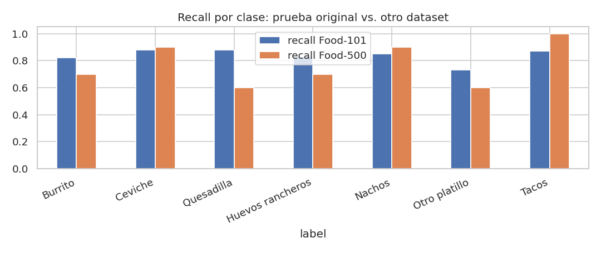
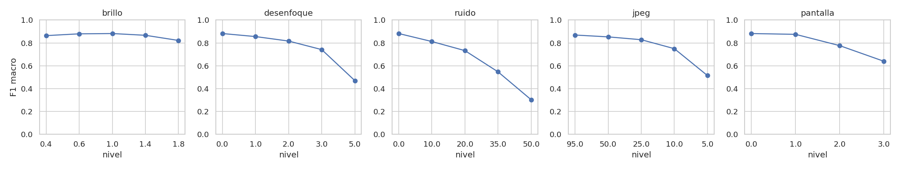
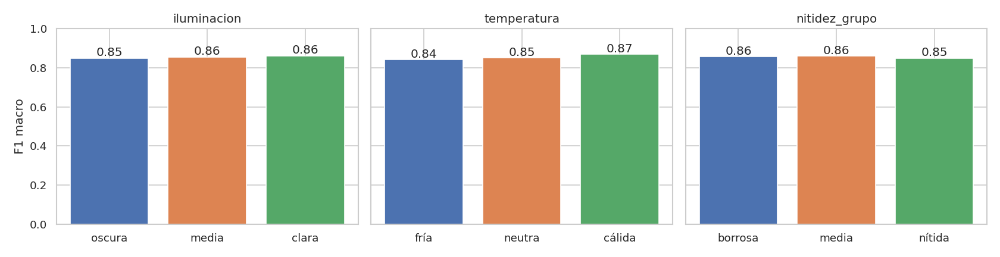

# Robustez y despliegue

Modelo: **MobileNetV3-Large** (versión final). Notebooks: [`eval/robustez.ipynb`](../eval/robustez.ipynb) y [`eval/auditoria_subgrupos.ipynb`](../eval/auditoria_subgrupos.ipynb).

## 1. Prueba fuera de distribución (ISIA Food-500)

Son 80 imágenes de otro conjunto, recolectado de forma independiente a Food-101 (ver `docs/datasheet.md`, sección 6). Para comparar en igualdad de condiciones, la prueba de Food-101 también se restringe a las **mismas 7 clases** (sin churros ni guacamole, que no existen en Food-500).

| Conjunto | n | Exactitud | F1 macro | Confianza media |
|---|---:|---:|---:|---:|
| Prueba Food-101 (9 clases) | 2,374 | 0.856 | 0.859 | 0.768 |
| Prueba Food-101 (mismas 7 clases) | 1,874 | 0.828 | 0.837 | 0.748 |
| **Food-500 (fuera de distribución)** | **80** | **0.750** | **0.767** | **0.724** |

| Clase | Recall Food-101 | Recall Food-500 |
|---|---:|---:|
| Burrito | 0.82 | 0.70 |
| Ceviche | 0.88 | 0.90 |
| Quesadilla | 0.88 | **0.60** |
| Huevos rancheros | 0.83 | 0.70 |
| Nachos | 0.85 | 0.90 |
| Otro platillo | 0.73 | **0.60** |
| Tacos | 0.87 | 1.00 |

**Lectura:**
- Fuera de distribución, el F1 macro baja **unos 7 puntos** (0.837 → 0.767).
- La confianza media también baja (0.748 → 0.724), así que el umbral de la app atrapa una parte de esa caída.
- Tacos se vuelve un "imán": recall de 1.0, pero precisión de solo 0.59. Burrito, huevos rancheros y quesadilla se van hacia tacos.
- Quesadilla es la clase más frágil: en Food-500 aparecen quesadillas de comal (de maíz, dobladas), distintas de las quesadillas Tex-Mex de harina cortadas en triángulos de Food-101.
- Con 10 imágenes por clase, cada imagen vale 10 puntos de recall. Estos números son orientativos.

## 2. Perturbaciones sintéticas

Se aplica cada perturbación a una muestra estratificada de la prueba (sección "Perturbaciones" del notebook). F1 macro sin perturbar en esa muestra: **0.882**.

| Perturbación | Leve | Media | Fuerte | Extrema |
|---|---:|---:|---:|---:|
| Brillo (factor) | 0.6 → 0.879 | 1.4 → 0.867 | 0.4 → 0.864 | 1.8 → 0.821 |
| Desenfoque gaussiano (σ) | 1 → 0.855 | 2 → 0.816 | 3 → 0.741 | 5 → 0.470 |
| Ruido gaussiano (σ) | 10 → 0.812 | 20 → 0.732 | 35 → 0.547 | 50 → 0.303 |
| Compresión JPEG (calidad) | 50 → 0.853 | 25 → 0.828 | 10 → 0.749 | 5 → 0.514 |
| Pantalla de celular simulada (nivel) | 1 → 0.875 | 2 → 0.776 | 3 → 0.640 | — |

**Lectura:**
- **Robusto a iluminación:** se pierden menos de 2 puntos entre 0.4× y 1.4× de brillo, gracias al `ColorJitter` del entrenamiento.
- **Frágil a ruido y desenfoque fuerte:** con desenfoque σ ≥ 3 o ruido σ ≥ 20, el F1 cae más de 10 puntos.
- **Foto en pantalla de celular (el caso de la demo):** el nivel leve casi no afecta (0.875); con moiré y reflejo fuerte cae a 0.64. Recomendación para la demo: brillo del celular al 70 % y sin reflejos directos.

## 3. Desempeño por subgrupo (condiciones de captura)

Se divide la prueba de Food-101 en terciles de cada atributo, medido sobre la imagen (`src/subgroups.py`).

| Atributo | Grupos | F1 macro por grupo | Brecha máx-mín |
|---|---|---|---:|
| Iluminación | oscura / media / clara | 0.850 / 0.856 / 0.862 | 1.2 pts |
| Temperatura de color | fría / neutra / cálida | 0.843 / 0.851 / 0.869 | **2.6 pts** |
| Nitidez | borrosa / media / nítida | 0.857 / 0.861 / 0.850 | 1.1 pts |

Las brechas son pequeñas (≤ 2.6 puntos). La mayor está en la luz **fría**: en Food-101 domina la luz cálida de restaurante, así que las fotos con luz fría (blanca de oficina o de cocina) quedan subrepresentadas.

## 4. Exportación y cuantización

Hardware de la demo: **MacBook con Apple M4**, CPU, 4 hilos, ONNX Runtime 1.32. Latencia de una imagen de 224×224 (20 de calentamiento y 200 medidas).

| Variante | Tamaño (MB) | F1 macro test | Latencia media (ms) | p95 (ms) | FPS del modelo |
|---|---:|---:|---:|---:|---:|
| PyTorch FP32 (eager) | 16.9 | 0.8585 | 72.9 | 93.5 | 13.7 |
| **ONNX Runtime FP32** (la que usa la demo) | 16.8 | **0.8585** | **7.2** | 8.4 | **138.6** |
| ONNX Runtime INT8 (estática QDQ) | 8.4 | 0.8076 | 4.4 | 4.7 | 229.2 |

**Antes y después:**
- **ONNX FP32 es 10 veces más rápido que PyTorch eager, con exactamente el mismo F1.**
- **INT8** reduce el tamaño a la mitad y la latencia en otro 40 %, pero **pierde 5 puntos de F1**.

**Decisión:** la demo usa **ONNX FP32** por defecto. Con 7 ms ya sobra velocidad, y no vale la pena perder 5 puntos de F1. INT8 queda disponible con `--int8` para equipos más lentos.

**Problema encontrado en la cuantización (y cómo se resolvió):**
1. Con la configuración por defecto (calibración MinMax con 200 imágenes de validación), el F1 del modelo INT8 **se desplomaba a 0.06**.
   - La causa: MobileNetV3 tiene activaciones *hardswish* y bloques *squeeze-and-excitation* con valores atípicos muy grandes. MinMax estira la escala para cubrirlos y los valores normales quedan en muy pocos niveles de cuantización.
2. Experimento en una muestra de 300 imágenes de prueba:

   | Configuración | F1 macro |
   |---|---:|
   | FP32 (referencia) | 0.838 |
   | MinMax, activaciones uint8 (original) | 0.141 |
   | MinMax, activaciones int8 | 0.132 |
   | MinMax, int8, primera conv y clasificador en FP32 | 0.125 |
   | Entropía, int8, primera conv y clasificador en FP32 | 0.125 |
   | Percentil 99.999, int8 | 0.791 |
   | **Percentil 99.999, int8, primera conv y clasificador en FP32** | **0.808** |

3. Se adoptó la última configuración en `src/export.py`. Para EfficientNet-B0 se calibró con 64 imágenes (`--calib-n 64`) por límite de RAM. Resultado: INT8 con F1 0.740 contra 0.872 en FP32, en una muestra de 600 imágenes de prueba.
4. **Trabajo futuro:** entrenamiento consciente de la cuantización (QAT) para cerrar la brecha de 5 puntos.

## 5. Tiempo real en la app

Medición del pipeline completo de `app/demo.py`: leer el cuadro, recortar, inferir, suavizar y dibujar. Se midieron 380 cuadros de `app/demo.mp4` en la Mac M4, sin la espera de la ventana:

| Modelo | FPS del pipeline | Latencia del modelo |
|---|---:|---:|
| ONNX FP32 | **68 FPS** | 13.1 ms |
| ONNX INT8 | 82 FPS | 10.7 ms |

- Con webcam, el límite es la cámara (normalmente 30 FPS), muy por encima del mínimo de **10 FPS**.
- La app muestra los FPS y la latencia **en pantalla** (figura `docs/figuras/demo_captura.png`).
- La demo dentro de Google Colab (webcam por el navegador) depende del internet y da 5–15 FPS. Es solo para mostrar el modelo; la demo oficial es la local.

## 6. Comportamiento ante baja confianza y casos límite

| Situación | Comportamiento |
|---|---|
| Confianza < umbral (0.55 por defecto, ajustable con el slider o con +/-) | Muestra **"No estoy seguro"** y la sugerencia de acercar el platillo; no muestra calorías |
| Clase "otro platillo" | Muestra **"Otro platillo (no mexicano)"**, sin calorías |
| Cuadro vacío o cámara tapada (desviación estándar < 8) | Muestra **"Sin imagen"** y reinicia el suavizado |
| Predicción parpadeante entre cuadros | Promedio móvil exponencial de las probabilidades (`--smooth 0.7`) |
| La cámara deja de responder | Reintenta y reabre la fuente de video automáticamente |

Efecto del umbral en la prueba: con 0.55, la app responde en 82.4 % de las imágenes y acierta en 92.5 % de esas respuestas (ver `docs/analisis_errores.md`).
